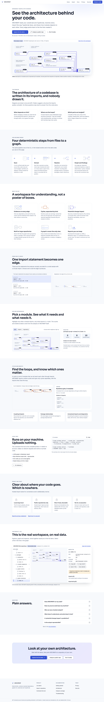
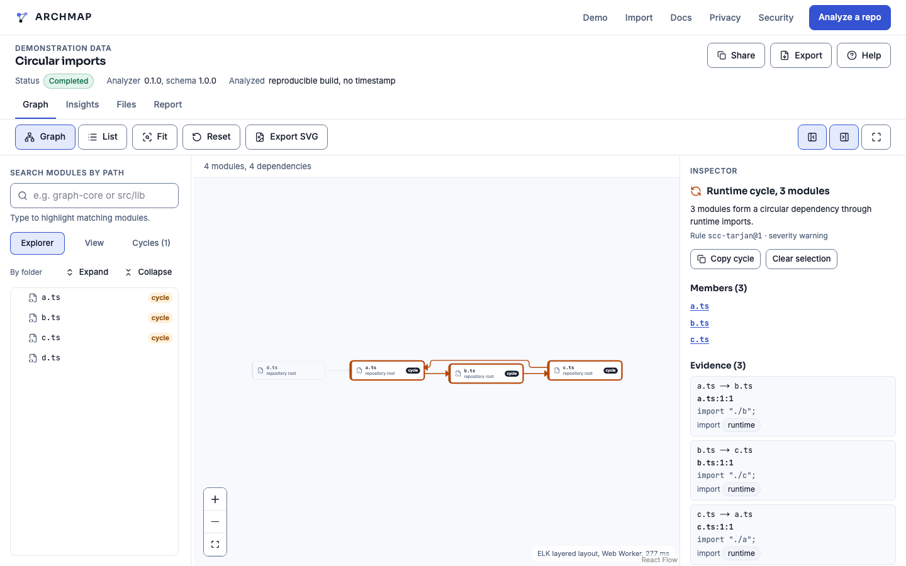
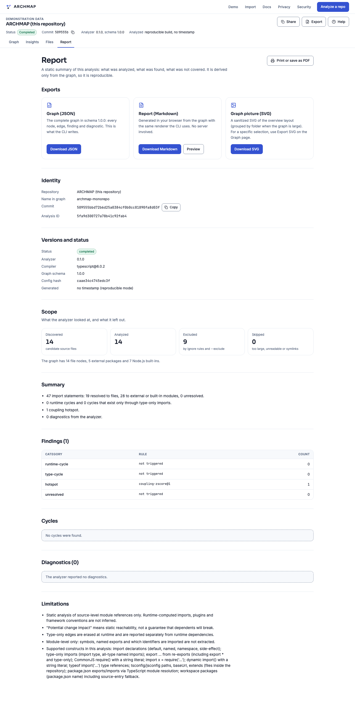
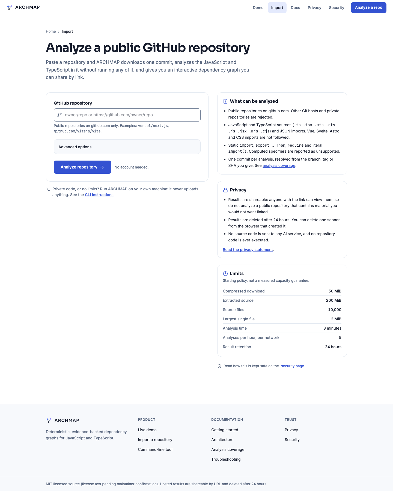
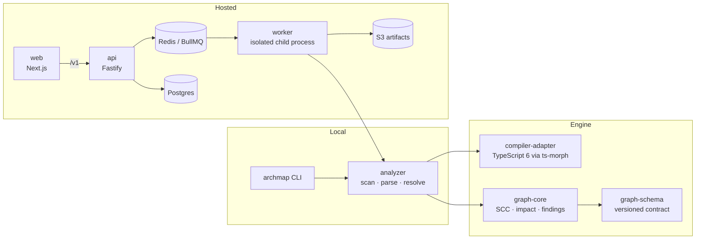

<div align="center">

# ARCHMAP

**See the architecture behind your code.**

Deterministic, evidence-backed dependency graphs for JavaScript and TypeScript repositories.
Every edge points to the exact line that created it.

[](https://github.com/Sendiw14/Archmap/actions/workflows/ci.yml)


[](LICENSE)

[Quick start](#quick-start) · [Features](#features) · [CLI](#cli) · [Web app](#web-app) · [How it works](#how-it-works) · [Docs](#documentation)



</div>

---

## Why ARCHMAP

Opening an unfamiliar codebase raises the same questions every time: _What depends on this module? What does it depend on? Are there cycles? What could my change affect? What couldn't be analyzed at all?_

ARCHMAP answers them from the source itself:

- **Evidence, not guesses.** Every dependency links to `file:line:column` and the import statement. Imports it can't resolve are listed with a reason, never silently dropped or guessed.
- **TypeScript-accurate resolution.** It uses TypeScript's own module resolution: `tsconfig` paths and `extends`, package `exports`/`imports`, custom conditions, workspace packages and project references.
- **Runtime vs type-only.** `import type` edges are erased at runtime, so cycles are reported separately for runtime and type-only imports.
- **Safe by design.** It parses syntax only. It never installs, builds or executes repository code, never follows symlinks and never reads outside the repository root.
- **Deterministic.** Same input, same output, byte for byte (`--reproducible`).

## Quick start

```bash
git clone https://github.com/Sendiw14/Archmap.git && cd Archmap
pnpm install
pnpm archmap analyze path/to/your/repo -f markdown
```

Requires **Node.js ≥ 22.18** and **pnpm 9**. Nothing is uploaded; analysis runs entirely on your machine.

```text
$ pnpm archmap analyze fixtures/circular -f markdown --reproducible

## Summary
- Source files analyzed: 4 (discovered 4, excluded 0, skipped 0)
- Dependency edges: 4 (4 resolved)
- Runtime cycles: 1; type-involved cycles: 0

## Cycles
- **runtime-cycle** (3): `a.ts` → `b.ts` → `c.ts`
```

## Features

<table>
<tr>
<td width="50%">

**Interactive graph workspace**
Pan, zoom, search and filter; select a module to see what it imports, what imports it, the source evidence for each edge and its **potential change impact** (direct and transitive dependents with paths). Graphs above 400 modules start grouped by folder.

</td>
<td width="50%">



</td>
</tr>
<tr>
<td>



</td>
<td>

**Insights and reports**
Runtime and type-only cycles (Tarjan SCC), coupling hotspots, package relationships, unresolved imports and diagnostics, each with the rule that produced it. Export **JSON**, **Markdown** or a sanitized **SVG** of the current view.

</td>
</tr>
<tr>
<td>

**Analyze a public GitHub repo**
Paste a URL; ARCHMAP downloads one commit, analyzes it in an isolated worker and gives you a shareable link for 24 hours. Only you (the creator) can cancel or delete it.

</td>
<td>



</td>
</tr>
</table>

Everything is keyboard-accessible, with a list view as a full alternative to the canvas. It is tested with axe on every route and has no page overflow from 320 px to 1920 px.

## CLI

```text
archmap analyze [path] [options]
  -f, --format <json|markdown>   output format (default: json)
  -o, --output <file>            write to a file instead of stdout
  -e, --exclude <glob...>        exclude repository-relative globs
      --max-files <n>            maximum source files (default 10000)
      --max-file-bytes <n>       skip larger files (default 2 MiB)
      --reproducible             omit the timestamp for byte-identical output
  -q, --quiet                    no progress output
archmap doctor                   check the environment
```

Exit codes: `0` success (including "completed with limitations"), `1` analysis failure, `2` invalid input.

Build a standalone, installable package with `pnpm build:cli` (output in `apps/cli/dist`, ready for `npm pack`).

### Output

JSON follows a versioned schema (`schemaVersion 1.0.0`, defined in [`packages/graph-schema`](packages/graph-schema/src/index.ts)):

```jsonc
{
  "metadata": { "analysisId": "…", "schemaVersion": "1.0.0", "repository": { "name": "…", "commit": "…" }, "status": "completed", … },
  "nodes":    [{ "id": "file:src/a.ts", "kind": "file", "path": "src/a.ts", "package": "@acme/app", "language": "ts" }],
  "edges":    [{ "source": "file:src/a.ts", "target": "file:src/b.ts", "importKind": "import",
                 "dependencyClass": "runtime", "resolution": "resolved",
                 "evidence": { "file": "src/a.ts", "line": 1, "column": 1, "text": "import { b } from \"./b\";" } }],
  "findings": [{ "category": "runtime-cycle", "nodes": ["file:src/a.ts", "…"], "rule": "scc-tarjan@1", … }],
  "diagnostics": [], "coverage": { … }
}
```

Edge direction is always **importing module → imported module**.

## Web app

```bash
pnpm --filter @archmap/api dev:memory      # offline API on :4000
pnpm --filter @archmap/web build
pnpm --filter @archmap/web start           # http://localhost:3000
```

The offline API analyzes the bundled fixtures (`archmap-fixtures/<name>`, e.g. `archmap-fixtures/circular`) through the real pipeline, without GitHub. `/demo` and `/analyses/demo-*` work with no API at all.

**Full hosted stack** (Postgres, Redis, S3-compatible storage, API, worker):

```bash
docker compose -f infrastructure/docker-compose.yml up -d --build   # API on :4100
ARCHMAP_API_URL=http://localhost:4100 pnpm --filter @archmap/web build && pnpm --filter @archmap/web start
```

## How it works



| Path                                                 | What it is                                                                              |
| ---------------------------------------------------- | --------------------------------------------------------------------------------------- |
| `packages/analyzer`                                  | Repository discovery, extraction, resolution, graph building                            |
| `packages/compiler-adapter`                          | The only code that touches the TypeScript API                                           |
| `packages/graph-core`                                | Algorithms: Tarjan SCC, potential impact, paths, aggregation, findings, Markdown report |
| `packages/graph-schema`                              | Zod schema for the graph (the contract between all parts)                               |
| `packages/contracts`                                 | Hosted API contract, error codes, job state machine                                     |
| `packages/hosted`                                    | Storage, queue, GitHub, safe extraction, job pipeline                                   |
| `apps/cli` · `apps/api` · `apps/worker` · `apps/web` | Entry points                                                                            |
| `fixtures/`                                          | Golden fixtures with hand-written expected results                                      |

## Privacy and security

- **Local CLI:** source never leaves your machine. No account, no telemetry.
- **Hosted:** public GitHub repositories only; results are shareable by link and deleted after 24 hours; no source is sent to AI services.
- Repository code is never executed. Archives are size-capped, and links, path traversal and decompression bombs are rejected. Analysis runs in a separate process with memory and time limits.

Details: [threat model](docs/security/threat-model.md) · [SECURITY.md](SECURITY.md) (report vulnerabilities privately).

## Quality

| Check                                        | Result                                     |
| -------------------------------------------- | ------------------------------------------ |
| Unit, golden-fixture, API and pipeline tests | 208 passing                                |
| End-to-end (Playwright) + axe accessibility  | 104 passing, 0 serious/critical violations |
| Real Postgres, Redis and S3 integration      | 7 passing                                  |
| CI                                           | Linux, macOS, Windows · Node 22 and 24     |

Benchmarks (Apple M4): 5,000-file synthetic repository in 0.5 s; `@aws-sdk/client-s3` (439 files, 4,570 imports) in 229 ms; search p95 34 ms on a 1,000-module graph. See [`docs/benchmarks`](docs/benchmarks).

## Documentation

- [Analysis coverage](docs/architecture/analysis-coverage.md): what is and is not supported
- [Architecture](docs/architecture/overview.md) and [decision records](docs/adr)
- [API (OpenAPI)](docs/api/openapi.json) · [Operations](docs/architecture/operations.md) · [Deployment](docs/architecture/deployment.md)
- [Product requirements](docs/requirements/prd.md) · [Status and release readiness](docs/status.md)

## Contributing

```bash
pnpm test && pnpm typecheck && pnpm lint && pnpm format
pnpm --filter @archmap/web test:e2e
```

New analyzer behavior starts with a fixture in `fixtures/<name>/` and a hand-written `expected.json`. See [CONTRIBUTING.md](CONTRIBUTING.md).

## License

[MIT](LICENSE)
