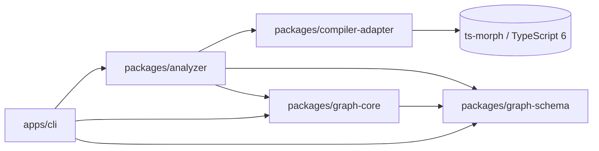

# Architecture overview

Pipeline: **scan** (root-confined walk, budgets) → **extract** (syntax-only parse per file) → **resolve** (virtual FS, nearest tsconfig) → **build graph** (sorted nodes/edges) → **algorithms** (SCC, findings) → **serialize** (JSON / Markdown).

Planned (not built): `apps/web` (Next.js) consumes graph JSON; `apps/api` (Fastify) + `apps/worker` (BullMQ) run the same analyzer on public GitHub archives in an isolated container. The analyzer has no dependency on any of them.
